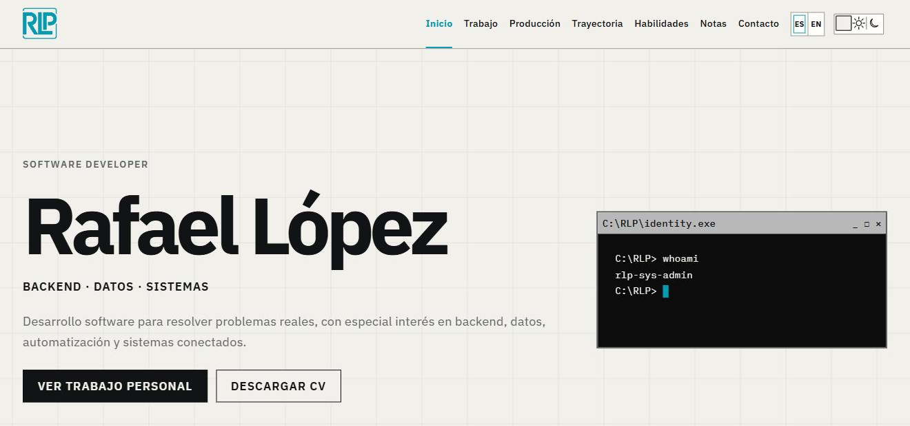

<div align="center">

# Rafael López

**Software Developer · Backend · Datos · Sistemas**

Software útil. Decisiones explicables. Trabajo verificable.

[Ver la web](https://rafalopezzz.github.io/web-site/) ·
[English version](https://rafalopezzz.github.io/web-site/en/) ·
[CV en PDF](https://rafalopezzz.github.io/web-site/cv/lopez-plana-rafael-2026.pdf) ·
[LinkedIn](https://www.linkedin.com/in/rafalopezzz/)

[](https://github.com/RafaLopezZz/web-site/actions/workflows/ci.yml)
[](https://github.com/RafaLopezZz/web-site/actions/workflows/deploy.yml)

<picture>
  <source media="(prefers-color-scheme: dark)" srcset="docs/readme/home-dark.png">
  
</picture>

</div>

> **In short:** source code of my portfolio. Static site built with Astro, bilingual (ES/EN), covered by end-to-end tests that run on every pull request.

## Qué es

El código de mi portfolio. Lo uso para enseñar proyectos propios y trabajo que está en producción, explicando qué problema resolvía cada uno y qué decidí por el camino.

Vengo de muchos años en hostelería. Allí aprendí que antes de ofrecer una solución hay que entender a la persona que tienes delante, y aquí intento hacer lo mismo: cada caso empieza por el problema, no por la tecnología.

## Qué hay dentro

### Trabajo propio

| Proyecto | Qué es | Stack | Enlaces |
| --- | --- | --- | --- |
| **ImportadorDB** | Programa de escritorio que pasa datos de Excel a una base de datos, con revisión previa y mapeo de columnas | Java 21 · JavaFX · JDBC | [Caso](https://rafalopezzz.github.io/web-site/work/importador-db/) · [Código](https://github.com/RafaLopezZz/importador-db) |
| **Cosecha en Cope** | Mi proyecto final de DAM: tienda online para productores agrícolas. Prototipo académico | Java · Spring Boot · Angular · PostgreSQL | [Caso](https://rafalopezzz.github.io/web-site/work/cosecha-en-cope/) · [Código](https://github.com/RafaLopezZz/CosechaEnCope) |
| **Glea-Nexo** | Laboratorio en curso: guardar y recuperar datos agrícolas cuando se corta la conexión. Usa datos simulados | Python · MQTT · Node-RED · Spring Boot · PostgreSQL | [Caso](https://rafalopezzz.github.io/web-site/work/glea-nexo/) · [Código](https://github.com/RafaLopezZz/glea-nexo) |

### En producción

Cuatro webs hechas en mi trabajo con Laravel 12 y MySQL: Águilas FC, La Ola Art Gallery, Quinta Bella y Fincas Victoria. Su código es privado; en la web explico qué hace cada una y cuál fue mi parte. [Ver los casos](https://rafalopezzz.github.io/web-site/production/).

## Decisiones

- **Sitio estático con Astro, sin framework de JavaScript en el cliente.** Es contenido para leer. Solo hay scripts pequeños para el tema, el menú y los carruseles.
- **El contenido son datos tipados.** Cada caso es un archivo TypeScript en `src/data/`. Si falta un campo o un idioma, falla la compilación y no la web.
- **Español e inglés con el mismo peso.** Cada ruta tiene su equivalente en `/en/`, y los tests comprueban que la estructura coincide.
- **Tema claro, oscuro o el del sistema.** El claro es el de referencia. La elección se guarda y no hay parpadeo al cargar.
- **Reglas de diseño por escrito.** [`DESIGN.md`](DESIGN.md) fija colores, tipografía, navegación y movimiento, incluido el respeto a `prefers-reduced-motion`.
- **Los tests son el contrato.** Si cambio la navegación, un idioma o el formulario, lo sé antes de publicar.

## Calidad

Más de 120 pruebas de extremo a extremo con Playwright. En cada pull request, GitHub Actions instala dependencias, pasa las pruebas y compila el sitio. Al fusionar en `master` se publica en GitHub Pages.

```bash
npm run test:e2e   # compila, levanta el sitio y pasa las pruebas
```

## Qué no demuestra este repositorio

Aquí no hay backend. Es un sitio estático y sirve para ver cómo organizo, pruebo y documento un proyecto. Mi código Java y Spring Boot está en [CosechaEnCope](https://github.com/RafaLopezZz/CosechaEnCope), [importador-db](https://github.com/RafaLopezZz/importador-db) y [glea-nexo](https://github.com/RafaLopezZz/glea-nexo).

## Uso de IA

Desarrollo con agentes de IA (OpenCode y Codex, entre otros) siguiendo un método: una especificación corta por cambio, un test que falla primero y revisión mía antes de cada commit. Las decisiones de diseño y de contenido son mías y están en `DESIGN.md` y en `docs/sdd/`.
